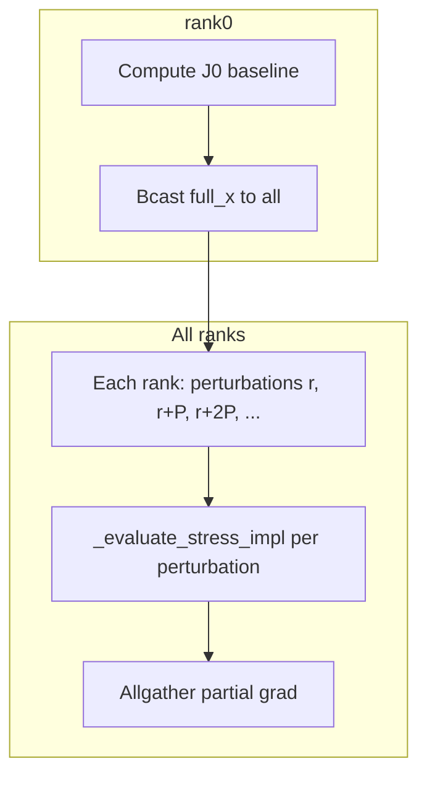

# Plan: MPI Parallelism for DOLFINx and dJ()

## Current State

- **Optimization:** Runs on rank 0 only; other ranks wait at barrier (`is_proc0()`).
- **Structural objective:** Only rank 0 calls `J()` and `dJ()`.
- **DOLFINx mesh:** Uses `COMM_SELF` in `_create_mesh_from_points_cells` so only the calling rank participates. Safe for rank-0-only flow.
- **DOLFINx support:** DOLFINx natively supports MPI: `create_mesh(COMM_WORLD, ...)` partitions the mesh; assembly and solve use PETSc in parallel.

## Goal

Run DOLFINx and dJ() with MPI to exploit multiple processes:
1. **Option A:** Parallel dJ() FD loop (split perturbations across ranks).
2. **Option B:** DOLFINx distributed solve (COMM_WORLD mesh, parallel assembly/solve).
3. **Option C:** Both (parallel FD loop + parallel solve per eval).

---

## Option A: Parallel dJ() FD Loop (Simpler)

**Idea:** Split the n finite-difference perturbations across MPI ranks. Rank r computes `grad[r::size]`; then Allgather to form the full gradient.

**Changes:**
1. Add `_compute_gradient_impl_mpi` in `StructuralStressObjective` that:
   - Rank 0 computes J0 baseline; broadcasts `full_x` to all.
   - Each rank computes its slice of perturbations (indices `r, r+P, r+2P, ...` where P = comm.size).
   - Each rank runs `_evaluate_stress_impl` with `full_x` set for its perturbations (need to apply perturbations and call eval).
   - Allgather the partial `grad` arrays into full `grad` on rank 0.
2. Gate: use MPI path only when `comm_world.size > 1` and structural backend is dolfinx (or skfem too).
3. **Challenge:** `full_x` must be set per perturbation. Each rank mutates `self.full_x` and calls `_evaluate_stress_impl`. The simsopt `full_x` is a property that triggers `set_dofs` on dependent objects. We must ensure only the calling rank’s coils are updated. Actually each rank has its own copy of coils (they’re replicated). So each rank can independently set `full_x = x0; full_x[i] = x0[i] + fd_step` for its indices i and evaluate. But `full_x` drives the coil DOFs—when we set it, the coils update. We need each rank to have the same coil objects (replicated) and only vary the specific DOF they’re perturbing. So each rank sets `full_x` for its subset of indices and runs the FEM. The key is that the coils are shared/replicated—each rank has the same in-memory state. When rank 2 sets `full_x[42] += fd_step`, does that affect the coils on other ranks? No—each process has its own memory. So we’re good: each rank independently sets its perturbation and evaluates. We just need to make sure we don’t have cross-rank dependencies (we don’t).

**Expected speedup:** Up to ~P× on the FD loop (n/ P solves per rank instead of n). Overhead: broadcast, allgather. For n~100–200, P=4, each rank does ~25–50 evals. Strong scaling.

---

## Option B: DOLFINx Distributed Solve (COMM_WORLD)

**Idea:** Use `COMM_WORLD` for mesh creation and solve so assembly and linear solve run in parallel across ranks.

**Requirements:**
- **Collective invocation:** All ranks must call into the structural code when `J()` or `dJ()` is evaluated. Currently only rank 0 does.
- **Flow change:** When the optimizer calls `prob.J()` or `prob.dJ()`, it’s only on rank 0. We need all ranks to participate. Options:
  - **B1:** Custom MPI-aware objective wrapper. When `J()` is called on rank 0, it broadcasts a “compute” signal; all ranks run `_evaluate_stress_dolfinx` with COMM_WORLD; result is reduced to rank 0.
  - **B2:** Change optimization loop so that when the problem has a structural term, the objective evaluation is done in an MPI collective block. E.g. before `scipy.minimize` calls the objective, we intercept and run our collective evaluation.
  - **B3:** Use simsopt’s MpiPartition if it supports distributing objective evaluation. Unclear.

**Implementation (B1-style):**
1. In `StructuralStressObjective.J()`: if `comm.size > 1`, barrier; rank 0 broadcasts `full_x`; all ranks call `_evaluate_stress_impl` (which uses COMM_WORLD in DOLFINx path). Rank 0 returns the scalar; others discard (or reduce to get same value on all).
2. In `_create_mesh_from_points_cells`: when `comm.size > 1`, use `COMM_WORLD` instead of `COMM_SELF`. Requires all ranks to call it with the same (x, cells). Rank 0 has these from deformed skfem mesh; broadcast to all.
3. In `_compute_body_force_dolfinx`: Each rank has a mesh partition. Quadrature points are distributed—each rank only computes J×B for its local points. The `_compute_jcross_b` receives coords for the local partition only. Need to pass the partitioned coords. DOLFINx `Q.tabulate_dof_coordinates()` returns local DOF coords—already partitioned. So body force computation is per-rank. Good.
4. In `_solve_elasticity_dolfinx`: Uses the distributed mesh; PETSc K and f are assembled in parallel; solve is parallel. No code change if mesh is already COMM_WORLD.
5. In `_compute_stress_dolfinx`: Von Mises is local per cell; need to take global max/mean. Use `MPI.allreduce` for `max(vm.x.array)`.

**Challenges:**
- `full_x` and coil state: All ranks must have the same coil DOFs when we deform the mesh. The coils are part of the optimization variables. When rank 0 evaluates J(x), x is the current optimizer state. All ranks need to apply the same x to their coils. So rank 0 must broadcast the full optimization vector before structural eval. The objective is `J(coils)`—the coils’ DOFs are the variables. So we need `full_x` (all DOFs) to be consistent. Rank 0 has it from the optimizer. Broadcast to all; each rank does `self.full_x = received_x` (or the optimizer’s state). That updates the coils on each rank. Then all ranks run deform_mesh (same result) and FEM.
- **Barrier placement:** The optimization loop runs only on rank 0. So we need a barrier before the structural objective is called, and all ranks must enter the structural code. The simsopt optimizer is unaware of MPI. The `optimize_coils_loop` builds a problem and calls `scipy.minimize`. The objective function is a closure that calls `prob.objective.J()`. That closure runs only on rank 0. So we need to insert an MPI barrier and broadcast at the start of `StructuralStressObjective.J()` and `dJ()`. But if only rank 0 calls `J()`, the other ranks never enter that function. So we need the other ranks to be “waiting” in a loop that listens for when rank 0 is about to evaluate. This is a typical MPI worker pattern: rank 0 sends “eval J” message; all ranks enter the structural evaluation; rank 0 returns. Implementation: at the start of `J()`, rank 0 does a broadcast (e.g. of a tag). All ranks must be in a matching receive. So all ranks need to be in a loop: “receive next action from rank 0”. When they receive “compute J”, they run the structural eval. The tricky part: the other ranks are waiting at a barrier in the optimization loop (before `_dispatch_optimization_on_proc0`). They never enter the objective. So we need to change the flow: instead of having rank 0 run the whole optimization while others wait, we need all ranks to run a “distributed optimization” where the objective evaluation is collective. That requires restructuring the optimization loop—not just the structural objective.

**Simpler approach:** Use a “scheduler” at the top level. When we detect MPI and structural objective, we run a different code path: all ranks enter a loop; rank 0 drives the optimizer (sends “eval J” or “eval dJ”); all ranks participate in structural when requested; rank 0 gets the result and continues the optimizer. This is a significant refactor of `optimize_coils_loop` and how the objective is invoked.

---

## Option C: Both (Parallel FD + Parallel Solve)

Combine A and B: parallel dJ() loop (each rank does a subset of perturbations) and each perturbation uses DOLFINx with COMM_WORLD (all ranks participate in that single solve). But then for each perturbation we need all ranks—so we can’t have different ranks working on different perturbations simultaneously. Unless we do a different strategy: for each perturbation, all ranks work together on one solve. So we’d have n sequential perturbation evals, but each eval is parallel across ranks. That’s Option B applied to dJ(). Option A is different: each rank does different perturbations in parallel, but each eval is serial per rank. So A and B are mutually exclusive for a single dJ() call—we either parallelize across perturbations (A) or within each solve (B). We could do A with B: each rank runs its perturbations, but for each perturbation all ranks participate in the solve. That would require rank 0 to broadcast “rank r is doing perturbation i”—then all ranks run the same perturbation i together. So we’d have P “teams” and we’d run them in sequence? No—that doesn’t work. With P ranks, we have two choices:
1. **Data parallelism on perturbations:** Ranks work on different perturbations (A). Each solve is serial (COMM_SELF).
2. **Data parallelism on single solve:** All ranks work on the same perturbation together (B). We run n iterations sequentially, each iteration parallel.

We could pipeline: while rank 0 is doing perturbation 0 with all ranks, we can’t同时 do perturbation 1. So we do 0, then 1, then 2, ... each parallel. That’s B for dJ().

---

## Recommended Implementation Order

| Phase | Task | Effort |
|-------|------|--------|
| **1** | **Option A: Parallel dJ() FD loop** | Medium |
| | Add `_compute_gradient_impl_mpi`; split perturbation indices across ranks; Allgather. | |
| | Gate with `comm.size > 1`. Ensure coil state is replicated before eval. | |
| **2** | **Validate Option A** | Low |
| | Run `mpirun -n 4 stellcoilbench submit-case cases/basic_LandremanPaulQA_structural.yaml`; compare dJ() time vs n=1. | |
| **3** | **Option B: DOLFINx COMM_WORLD (single J eval)** | High |
| | Refactor so all ranks enter structural eval when J() is called. | |
| | Requires optimization-loop changes (collective objective evaluation). | |
| **4** | **Combine** | |
| | Once B works for J(), extend to dJ() so each of the n+1 evals uses COMM_WORLD. | |

---

## File Touches (Option A)

- [\_structural_objective.py](src/stellcoilbench/coil_optimization/_structural_objective.py): Add `_compute_gradient_impl_mpi`, call it from `dJ()` when `comm.size > 1`.
- [mpi_utils.py](src/stellcoilbench/mpi_utils.py): Use `comm_world` for Allgather; ensure `comm_world` is available.
- [\_optimization_loop.py](src/stellcoilbench/coil_optimization/_optimization_loop.py): Ensure coils and BiotSavart are replicated on all ranks (they likely are, since we only run optimization on rank 0 but all ranks have the same imports).

---

## File Touches (Option B)

- [\_structural_objective.py](src/stellcoilbench/coil_optimization/_structural_objective.py): In `J()` and `_evaluate_stress_impl`, add MPI collective path; broadcast `full_x`; use COMM_WORLD in DOLFINx.
- [\_dolfinx.py](src/stellcoilbench/structural_analysis/_dolfinx.py): `_create_mesh_from_points_cells(comm=COMM_WORLD)` when in MPI mode.
- [optimization.py](src/stellcoilbench/coil_optimization/optimization.py) / dispatch: Structural objective evaluation must be invoked in a way that all ranks participate. Need a wrapper or a different optimization entry point for MPI+structural.
